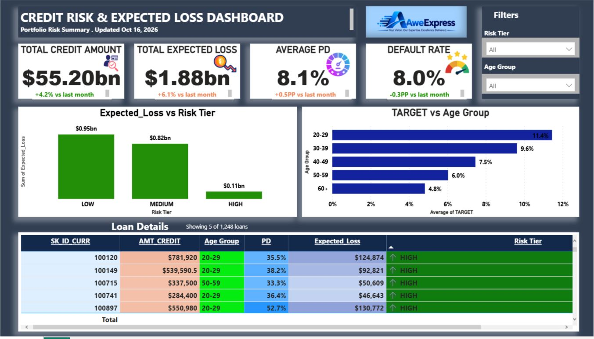

# Credit Risk Scoring & $55.2bn Portfolio Dashboard

> End-to-end credit risk model: 307k loans, Logistic Regression, Expected Loss = PD * LGD * EAD

### Business Problem
Bank needs to quantify risk on $55.2bn loan portfolio and price loans by risk tier.

### Key Results (from your dashboard)
- **Total Exposure:** $55.20bn
- **Total Expected Loss:** $1.88bn
- **Avg Probability of Default:** 8.1%
- **High Risk Tier:** 52.7% PD, $0.11bn exposure

### Model Performance
- Model: Logistic Regression (glm)
- Accuracy: 91.9%
- AUC: 0.76
- Target: TARGET (1 = default)

### Data Cleaning - R
- `01_data_cleaning.R`: Missing values, Age Group, DAYS_BIRTH to Age
- `02_credit_risk_metrics.R`: PD prediction, Expected_Loss = PD * 0.6 * AMT_CREDIT, Risk_Tier (Low/Med/High)
- `03_logistic_model.R`: glm, confusion matrix, AUC

### Dashboard - Power BI
- KPIs: Total Credit, Expected Loss, Avg PD, High Risk Share
- Charts: Expected Loss by Risk Tier, TARGET by Age Group
- Table: Loan Details with SK_ID_CURR, PD, Expected Loss, Risk Badge

### Tech Stack
R (tidyverse, caret, pROC), Power BI, DAX

### Files
- `/R` - 3 R scripts
- `/dashboard` - .pbix + screenshot
- `/data` - 1k sample (full data: [Kaggle Home Credit](https://www.kaggle.com/c/home-credit-default-risk))

